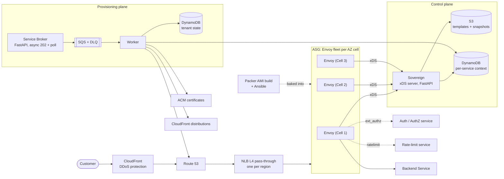

# Open Service Broker (OSB) Edge Platform
### *Services as Configuration, Not Infrastructure*

[](https://github.com/nimishmehta8779/osb/actions/workflows/ci.yml)
[](product_architecture.md)
[](https://www.envoyproxy.io/)
[](https://www.terraform.io/)
[](https://www.python.org/)
[](LICENSE)

A self-service enterprise edge platform where internal engineering teams publish HTTP(S) microservices through a hardened, shared cloud edge. 

Instead of provisioning dedicated Application Load Balancers (ALBs), public IP addresses, and DNS certificates for every service, **onboarding a service is modeled as declarative configuration**.

> **The platform owns the infrastructure. Product teams own the service intent.**

---

## Product Architecture

The platform decouples operational lifecycles into **Three Autonomous Planes**, guaranteeing that control-plane or provisioning disruptions cannot impact live customer traffic.



### The Three Autonomous Planes

| Plane | Responsibility | Components | Operational Cadence |
| :--- | :--- | :--- | :--- |
| **Data Plane** | Carries customer traffic with static stability | CloudFront, Route 53, NLB (L4 pass-through), Envoy ASG (AZ cells), Backend workloads | Microseconds |
| **Control Plane** | Renders and distributes Envoy xDS configs | Sovereign (xDS server, FastAPI), S3 templates, DynamoDB active context | Seconds (15s poll) |
| **Provisioning Plane** | Accepts and coordinates tenant lifecycle sagas | Service Broker (FastAPI), SQS + DLQ, Worker daemon, DynamoDB state | Minutes |

#### 1. Data Plane (Request Path)
1. **Perimeter:** Customer traffic enters CloudFront for perimeter DDoS protection and TLS termination.
2. **Layer 4 Transit:** CloudFront forwards TCP streams to an AWS Network Load Balancer (NLB) in the target region (zero HTTP inspection).
3. **Ingress Envoy ASG:** The NLB forwards traffic across healthy Envoy instances partitioned into AZ cells.
4. **Traffic Policies:** Envoy evaluates local route matching, authentication (`ext_authz`), token-bucket rate limiting (`local_ratelimit`), and proxies to upstream private backend clusters.

#### 2. Control Plane (Configuration Distribution)
1. Active tenant context is maintained in DynamoDB and Jinja2 templates in S3.
2. Sovereign compiles dynamic discovery resources (LDS, CDS, RDS).
3. Local LKG agents on each Envoy instance poll Sovereign, validate the snapshot, and write atomically to `/var/lib/osb/lkg/`.
4. If Sovereign or DynamoDB is down, Envoy continues serving from local disk (**Static Stability**).

#### 3. Provisioning Plane (Tenant Lifecycle Saga)
1. Client calls the Service Broker with an API key (`PUT /v2/service_instances/{id}`).
2. Broker writes `PENDING` to DynamoDB, enqueues the request to SQS, and returns `HTTP 202 Accepted`.
3. The Worker daemon executes the cross-AWS saga (DynamoDB lock ➔ ACM cert ➔ Route 53 DNS ➔ CloudFront ➔ Reachability check) with automatic reverse compensation on failure.
4. Only verified `ACTIVE` tenants are published to Sovereign; unready tenants are quarantined.

---

## Core Architectural Invariants

- **Static Stability (Last-Known-Good):** Live customer traffic has **zero runtime dependency** on the control plane or databases. A local daemon (`envoy/lkg-agent/agent.py`) polls Sovereign, validates candidate configurations, and atomically writes valid snapshots to local encrypted EBS (`/var/lib/osb/lkg/lds.json`). If Sovereign, S3, or DynamoDB crashes, Envoy continues serving 100% of live traffic from local disk.
- **Cell-Based Blast-Radius Control:** Envoy fleets are partitioned into discrete AZ cells (1 Cell = 1 AZ Envoy fleet). Outages and configuration rollouts are constrained to single cells before regional promotion.
- **Transactional Provisioning Saga:** Cross-AWS API orchestration (DynamoDB lock ➔ ACM cert ➔ Route 53 DNS ➔ CloudFront ➔ Reachability check) is executed as an asynchronous distributed saga. If any step fails, all preceding steps are compensated in reverse order. Unready or failing tenants are strictly quarantined from the traffic plane.
- **Tenant Isolation:** Every tenant is automatically bound to token-bucket rate limits (`local_ratelimit`), bandwidth caps, and backend connection circuit breakers (`max_connections`, `max_pending_requests`).

---

## Repository Layout

```
.
├── deploy.sh                     # Unified CLI for local dev, testing, and AWS Terraform
├── docker-compose.local.yml       # Complete local 9-container mock platform
├── product_architecture.md       # Canonical enterprise architecture specification
├── envoy/                        # Envoy bootstrap, user-data, and Last-Known-Good agent
│   ├── bootstrap/                # Static & dynamic Envoy bootstraps (path_config_source)
│   ├── install/                  # EC2 user_data boot templates
│   └── lkg-agent/                # Local Python agent polling Sovereign & managing LKG files
├── infra/                        # Infrastructure as Code (Terraform 1.6+)
│   ├── main.tf                   # Direct root Terraform deployment
│   └── modules/                  # Reusable modules (network, edge-region, control-plane, etc.)
├── services/                     # Application source code
│   ├── broker/                   # FastAPI Open Service Broker API (async 202 + poll)
│   ├── worker/                   # SQS saga consumer & AWS resource orchestrator
│   ├── sovereign/                # xDS dynamic configuration server & Jinja2 templates
│   ├── common/                   # Shared tenant models, DynamoDB stores, and API key auth
│   └── local/                    # Local development AWS mock initializers
└── docs/                         # Platform documentation suite
    ├── README.md                 # Documentation index & guide
    ├── architecture.md           # Three planes, static stability, and sagas
    ├── api-reference.md          # Open Service Broker REST API reference
    ├── operations.md             # Day-2 runbooks, local dev, monitoring & DR
    ├── engineering-story.md      # In-depth architectural case study
    └── diagrams/                 # Master production architecture assets (PNG, SVG, Excalidraw)
```

---

## Quickstart: 60-Second Local Run

Experience the complete edge platform locally without an AWS account using Docker Compose (simulating DynamoDB Local, ElasticMQ for SQS, Mock DNS, Sovereign, LKG Agent, and Envoy):

### 1. Launch the Stack
```bash
./deploy.sh local-up
```

### 2. Onboard a Service
Submit a declarative service intent using the pre-seeded local API key:

```bash
curl -X PUT http://localhost:8000/v2/service_instances/demo-service \
  -H "X-Api-Key: local-dev-only" \
  -H "Content-Type: application/json" \
  -d '{
    "service_id": "web-api",
    "parameters": {
      "hostname": "app1.osb.internal",
      "backend_host": "backend-demo",
      "backend_port": 80,
      "rate_limit_rps": 100,
      "bandwidth_kbps": 10000
    }
  }'
```

### 3. Check Provisioning Status
Poll the asynchronous operation status:

```bash
curl -s http://localhost:8000/v2/service_instances/demo-service/last_operation \
  -H "X-Api-Key: local-dev-only"
# Returns: {"state": "succeeded", "description": "Provisioning complete"}
```

### 4. Send Live Traffic
Send an HTTP request through Envoy's local ingress (port `10000`):

```bash
curl -H "Host: app1.osb.internal" http://localhost:10000/
# Returns response forwarded from backend-demo!
```

### 5. Tear Down Local Stack
```bash
./deploy.sh local-down
```

---

## AWS Deployment Guide

### Prerequisites
- [Terraform](https://developer.hashicorp.com/terraform/downloads) `>= 1.6`
- [AWS CLI v2](https://docs.aws.amazon.com/cli/latest/userguide/getting-started-install.html) configured with deployment credentials
- [Docker](https://docs.docker.com/get-docker/) & [Python 3.12](https://www.python.org/)

### 1. Verify Environment & Credentials
```bash
./deploy.sh check
```

### 2. Plan and Apply Infrastructure
```bash
# Preview changes (provisions VPC, NLB, Envoy, Sovereign, Broker, Worker, DynamoDB, SQS)
./deploy.sh plan

# Apply changes to AWS
./deploy.sh apply
```

### 3. Seed Team API Key
Generate a secure SHA-256 team API key stored in DynamoDB:

```bash
./deploy.sh seed-key finance-team my-super-secret-key-123
```

### 4. Check Deployment Status
Inspect running EC2 instances, NLB endpoints, and SQS queues:

```bash
./deploy.sh status
```

### 5. Teardown
To cleanly destroy all provisioned AWS cloud infrastructure:

```bash
./deploy.sh destroy
```

---

## Open Service Broker API Reference

The Service Broker implements an asynchronous, idempotent REST API:

| Method | Endpoint | Description | Expected Status |
|---|---|---|---|
| `PUT` | `/v2/service_instances/{id}` | Provision or update a service specification | `202 Accepted` |
| `GET` | `/v2/service_instances/{id}/last_operation` | Poll asynchronous provisioning operation status | `200 OK` |
| `DELETE` | `/v2/service_instances/{id}` | Decommission service & release hostname/DNS | `202 Accepted` |
| `GET` | `/internal/context/tenants` | Internal Sovereign feed (returns `ACTIVE` tenants only) | `200 OK` |

Every tenant request requires an `X-Api-Key` header mapped to a registered `team_id`. Teams can only inspect or modify their own services.

---

## Running the Test Suite

The platform includes a comprehensive automated test suite (72 unit and contract tests):

```bash
# Run unit tests via deploy orchestrator
./deploy.sh test

# Or run directly via Python unittest
PYTHONPATH=. python3 -m unittest \
  services.common.tests.test_store \
  services.broker.tests.test_api \
  services.worker.tests.test_saga \
  services.worker.tests.test_worker \
  services.sovereign.tests.test_templates

(cd envoy/lkg-agent && python3 -m unittest test_agent)
```

---

## Architecture Decision Records & Design Status

- **Status:** **DRAFT for Confirmation.** Core mechanics have been verified in isolated environments; full enterprise scale is subject to formal Architecture Decision Records (ADRs).
- **Documentation Suite:** See the [Documentation Hub](docs/README.md), [Architecture Guide](docs/architecture.md), [API Reference](docs/api-reference.md), and [Operations Guide](docs/operations.md).
- **In-Depth Architectural Case Study:** See [`docs/engineering-story.md`](docs/engineering-story.md).
- **Open Architectural Decisions:**
  - TLS termination boundary (CloudFront vs. NLB vs. Envoy).
  - CloudFront tenancy model (Shared vs. Dedicated distributions).
  - Production scale, latency SLOs, and automatic rollback abort thresholds.

---

## License

This project is licensed under the Apache License, Version 2.0. See [LICENSE](LICENSE) for details.
