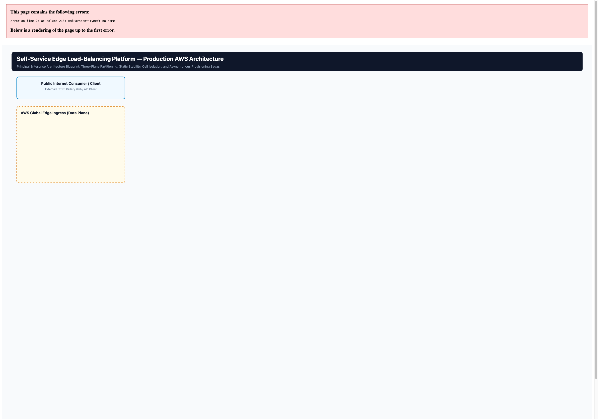

# Services as Configuration, Not Infrastructure: Architectural Anatomy of a Resilient, Self-Service Enterprise Edge Platform

**Author:** AWS Principal Solutions Architect & Enterprise Systems Specialist  
**Target Publication:** Medium Engineering / Systems Architecture  
**Status:** Canonical Architecture Blueprint (Design Status: DRAFT for Confirmation)  
**Associated Diagram Assets:**  
- Editable Canvas: [`diagrams/aws_edge_platform_production.excalidraw`](diagrams/aws_edge_platform_production.excalidraw)  
- Standalone Vector SVG: [`diagrams/aws_edge_platform_production.svg`](diagrams/aws_edge_platform_production.svg)  
- High-Resolution PNG: [`diagrams/aws_edge_platform_production.png`](diagrams/aws_edge_platform_production.png)  

---

## The Principal Architect’s Opening Hook

What happens when an enterprise scales to hundreds or thousands of internal microservices that all require hardened, compliant, internet-facing ingress—but provisioning a dedicated load balancer, public IP allocation, CDN distribution, and certificate lifecycle for every single service becomes the infrastructure problem itself?

In traditional cloud operations, the knee-jerk reaction to an edge exposure request is simple: *run Terraform and spin up an Application Load Balancer (ALB).*

```
[Traditional Ingress Model: Infrastructure Sprawl]
Tenant Service A  ──► Dedicated ALB ──► Dedicated ACM Cert ──► Dedicated WAF / DNS
Tenant Service B  ──► Dedicated ALB ──► Dedicated ACM Cert ──► Dedicated WAF / DNS
Tenant Service C  ──► Dedicated ALB ──► Dedicated ACM Cert ──► Dedicated WAF / DNS
...
Tenant Service N  ──► Dedicated ALB ──► Dedicated ACM Cert ──► Dedicated WAF / DNS
```

At enterprise scale, this intuitive pattern collapses under its own weight:
1. **Financial Hemorrhage:** Hundreds of idle or low-traffic ALBs generate massive baseline costs in hourly instance charges and Load Balancer Capacity Units (LCUs).
2. **IP & Quota Exhaustion:** Private and public subnet CIDRs exhaust their available IP addresses on Elastic Network Interfaces (ENIs); AWS account quotas on certificates, load balancers, and CloudFront distributions rapidly hit hard ceilings.
3. **Security Drift:** Every product team tunes its own cipher suites, security group ingress rules, and WAF configurations. Auditing edge compliance becomes an exercise in forensic archaeology.
4. **Operational Bottlenecks:** Onboarding a new service requires infrastructure pipeline runs, DNS delegation tickets, and multi-team handoffs that stretch lead times from minutes to weeks.

The architectural question that breaks this deadlock is fundamentally about operating models:

> **What if an internet-facing service were modeled purely as configuration rather than infrastructure?**

Under this paradigm, onboarding a new service never creates a new load balancer. The platform engineering team provisions, hardens, and operates a shared, multi-tenant edge infrastructure once. Product teams express their *service intent*—hostnames, routing paths, target backend clusters, bandwidth limits, and rate-limiting quotas—declaratively via a self-service API. The platform asynchronously ingests that intent and translates it into dynamic proxy configuration.

**The platform owns the infrastructure. Product teams own the service intent.**

---

## What This Solution Will Achieve

Transforming edge routing from an infrastructure problem into a declarative configuration problem delivers radical architectural and operational outcomes:

```
+---------------------------------------------------------------------------------------------------------------+
|                                      OPERATIONAL & ARCHITECTURAL OUTCOMES                                     |
+---------------------------------------------------------------------------------------------------------------+
| 1. ZERO LOAD-BALANCER SPRAWL                                                                                  |
|    Hundreds of internal services collapse into a single, shared, hardened ingress fleet per region.           |
|                                                                                                               |
| 2. SUB-MINUTE ASYNCHRONOUS ONBOARDING                                                                         |
|    Developers publish services via an idempotent API call (HTTP 202 Accepted) without submitting cloud tickets |
|    or executing Terraform pipelines.                                                                          |
|                                                                                                               |
| 3. ABSOLUTE STATIC STABILITY                                                                                  |
|    Live customer traffic runs with zero runtime dependency on the control plane or databases. Even if the     |
|    entire configuration engine crashes, edge proxies continue routing 100% of live traffic from local disk.  |
|                                                                                                               |
| 4. STRICT CELLULAR BLAST-RADIUS CONTAINMENT                                                                   |
|    Envoy proxies are partitioned into Availability Zone cells and shuffle shards. A poison-pill payload or    |
|    noisy neighbor is mathematically isolated to a fraction of the fleet.                                      |
|                                                                                                               |
| 5. UNIFIED SECURITY & POLICY GOVERNANCE                                                                       |
|    DDoS mitigation (CloudFront), Layer 4 boundary enforcement (NLB), authentication offloading (ext_authz),   |
|    and tenant rate-limiting (ratelimit) are enforced deterministically at the edge before backend invocation. |
+---------------------------------------------------------------------------------------------------------------+
```

---

## Architectural Tensions: Engineering Trade-offs at the Edge

A distributed systems architecture is only as sound as the tensions it deliberately reconciles. This platform resolves eight critical tensions:

| # | Architectural Tension | The Failure Mode if Unchecked | How the Architecture Resolves It |
|---|---|---|---|
| **1** | **Self-Service vs. Central Governance** | Wildfire edge exposure; inconsistent TLS ciphers; unmonitored DNS sprawl. | The Provisioning Plane strictly mediates edge resources. Only an automated Worker IAM role can provision DNS records and CloudFront distributions; tenant requests must pass programmatic schema checks. |
| **2** | **Shared Edge vs. Tenant Isolation** | A runaway microservice monopolizes proxy worker threads, crashing neighbors. | Envoy per-tenant `local_ratelimit` filters, bandwidth caps, connection circuit breakers (`max_connections`, `max_pending_requests`), and cell-level shuffle sharding. |
| **3** | **Dynamic Configuration vs. Static Stability** | A control plane database glitch causes regional edge proxies to drop traffic. | **Static Stability via Last-Known-Good (LKG):** Proxies route traffic exclusively using validated configuration files persisted to encrypted local EBS storage (`/var/lib/osb/lkg/lds.json`). |
| **4** | **Fast Provisioning vs. Safe Provisioning** | Race conditions expose partially configured or unvalidated backends to users. | **Asynchronous Saga Orchestration:** The Broker acknowledges via `202 Accepted`. A Worker executes sequential provisioning with compensating rollbacks. Tenants are marked `ACTIVE` only after socket verification. |
| **5** | **Central Control vs. Data-Plane Independence** | Edge proxies query a central control database synchronously for every request. | Control plane engines pre-render service intent into local Envoy filter chains. The live data plane executes with zero network calls back to the control plane. |
| **6** | **Multi-Tenancy vs. Blast-Radius Control** | A corrupted routing definition takes down the entire proxy fleet simultaneously. | **Cellular Partitioning:** The fleet is divided into AZ-scoped cells. Staged rollouts (Canary → Cell 1 → Regional Fleet) ensure a bad change is caught before widespread propagation. |
| **7** | **Automation vs. Rollback / Compensation** | Orphaned DNS records and ACM certificates litter the account after failed deploys. | The Worker saga engine implements explicit, idempotent compensating actions in reverse order for every forward step. |
| **8** | **High Availability vs. Operational Complexity** | Multi-master control planes cascading into split-brain and synchronization deadlocks. | Asynchronous pull-based configuration distribution with exponential backoff and jitter, backed by S3 snapshots and DynamoDB context tables. |

---

## The Three-Plane Model: Decoupling by Operational Lifecycle

The fatal flaw of naive load-balancing platforms is conflating operational lifecycles. When tenant management APIs, configuration distribution servers, and live proxy processes share memory, processes, or tight synchronization loops, an operational failure in tenant registration inevitably triggers a customer-facing traffic outage.

This platform enforces a strict separation into **Three Autonomous Planes**:

```
┌───────────────────────────────────────────────────────────────────────────────────────────────────────┐
│                                         PROVISIONING PLANE                                            │
│   Client Request ──► Service Broker ──► Amazon SQS ──► Worker Orchestrator ──► AWS APIs (ACM/R53/CF)   │
│   Operational Lifecycle: Minutes (Asynchronous, Eventual Consistency, Distributed Sagas)             │
└───────────────────────────────────────────────────┬───────────────────────────────────────────────────┘
                                                    │ Writes ACTIVE Tenant Context
                                                    ▼
┌───────────────────────────────────────────────────────────────────────────────────────────────────────┐
│                                           CONTROL PLANE                                               │
│   Active Context ──► Sovereign xDS Server ──► Jinja2 Templates ──► Versioned Amazon S3 Snapshots     │
│   Operational Lifecycle: Seconds (Dynamic Configuration Generation, Schema Validation)                │
└───────────────────────────────────────────────────┬───────────────────────────────────────────────────┘
                                                    │ Polls xDS & Persists LKG to Local Disk
                                                    ▼
┌───────────────────────────────────────────────────────────────────────────────────────────────────────┐
│                                            DATA PLANE                                                 │
│   Customer ──► Amazon CloudFront ──► AWS NLB (L4) ──► Envoy Multi-AZ Cells ──► Backend Workloads     │
│   Operational Lifecycle: Microseconds (Statically Stable, Zero External Runtime Dependencies)         │
└───────────────────────────────────────────────────────────────────────────────────────────────────────┘
```

### 1. The Data Plane (Traffic Handling)
- **Role:** Carries live customer traffic from the internet to internal VPC backends.
- **Components:** Amazon CloudFront, Amazon Route 53, AWS Network Load Balancer (NLB), Auto Scaling Groups of Envoy proxies, sidecar filters (`ext_authz`, `ratelimit`), and target application clusters.
- **Resilience Invariant:** Zero runtime dependency on upstream planes. If the control plane, SQS queue, and DynamoDB tables evaporate completely, running proxies continue serving live traffic uninterrupted.

### 2. The Control Plane (Configuration Generation & Distribution)
- **Role:** Converts declarative tenant context into concrete Envoy discovery resources (LDS, CDS, RDS).
- **Components:** **Sovereign** (a specialized xDS control plane daemon running under FastAPI), versioned Amazon S3 template and snapshot buckets, and Amazon DynamoDB context tables.
- **Resilience Invariant:** Asynchronous and decoupled. If Sovereign or DynamoDB fails, configuration updates pause, but running proxies experience zero degradation.

### 3. The Provisioning Plane (Tenant Lifecycle Orchestration)
- **Role:** Exposes self-service APIs to internal developers, validates specifications, manages tenant state machines, and orchestrates AWS edge resources.
- **Components:** **Service Broker** (FastAPI implementing Open Service Broker patterns), Amazon SQS with Dead-Letter Queues (DLQ), Worker orchestrators executing transactional sagas, and DynamoDB tenant/hostname state tables.
- **Resilience Invariant:** Eventual consistency. Tenant onboarding can degrade or halt without impacting either active configuration generation or live customer routing.

---

## Production AWS Architecture Diagram

The master architecture diagram visualizes the three planes, official AWS service icons, regional containment, Availability Zone cells, and failure boundaries:


*Figure 1: Production AWS Architecture Diagram with Official AWS Architecture Icons. Available as an interactive canvas at [`diagrams/aws_edge_platform_production.excalidraw`](diagrams/aws_edge_platform_production.excalidraw) and vector SVG at [`diagrams/aws_edge_platform_production.svg`](diagrams/aws_edge_platform_production.svg).*

---

## Walk the Wire: The Microsecond Request Path

To appreciate the isolation of the data plane, follow an incoming request as it traverses the wire:

```
[Internet Consumer]
         │
         ▼ (1) DNS Resolution (Alias Record)
[Amazon Route 53]
         │
         ▼ (2) HTTPS Request
[Amazon CloudFront] ── Applies DDoS mitigation & edge caching; TLS termination point [TBD]
         │
         ▼ (3) Forward to Regional Origin
[AWS Network Load Balancer (NLB)] ── L4 TCP pass-through; preserves client IP; zero HTTP inspection
         │
         ▼ (4) L4 Target Group Distribution (Port 80 / 443 TCP)
[Envoy Proxy Instance (Selected AZ Cell)]
         │
         ├──► (5a) VirtualHost Route Matching (derived from Host header)
         │
         ├──► (5b) ext_authz Sidecar Filter (verifies auth token / claims)
         │
         ├──► (5c) ratelimit Sidecar Filter (token bucket checks tenant RPS limit)
         │
         ▼ (6) Forward to Backend Cluster
[Internal Backend Application Workload]
```

### Architectural Roles Along the Data Path
1. **Amazon Route 53:** Resolves the provisioned service hostname (e.g., `api.example.com`). All tenant DNS records are owned and created strictly by the platform Worker identity.
2. **Amazon CloudFront:** Acts as the outer shield against volumetric Layer 3/4 and Layer 7 DDoS attacks. *[TBD: Confirm whether TLS terminates exclusively at CloudFront, passes through to Envoy, or re-encrypts between CloudFront and NLB]*.
3. **AWS Network Load Balancer (NLB):** Operates strictly as a Layer 4 pass-through. It inspects neither HTTP headers nor TLS packets, avoiding the overhead, stateful buffering, and operational complexity of Layer 7 load balancers at the regional perimeter.
4. **Envoy Proxy (Cell Fleet):** Acts as the policy enforcement point. It terminates or inspects the TLS stream, matches the `Host` header against dynamically compiled virtual hosts, and initiates filter evaluations in deterministic order:
   - **Route Match:** Maps the host/path pattern to a designated backend cluster. If no match exists, traffic hits an immutable catch-all route answering `HTTP 200: osb edge ok` (serving as an edge health verifier).
   - **`ext_authz` Enforcement:** Delegates authentication and coarse authorization to a dedicated sidecar or internal authority, ensuring unauthenticated requests never reach tenant backend code.
   - **`ratelimit` Enforcement:** Applies tenant-specific token-bucket algorithms. Tenant limits (defaulting to platform baselines, e.g., 100 RPS / 10 Mbps bandwidth tiers, up to operator-approved ceilings) protect the shared edge from unbounded consumption.
5. **Backend Clusters:** The target workload receives sanitized, authenticated requests across private VPC subnets.

---

## Static Stability: Live Traffic Never Depends on a Live Control Plane

In distributed systems theory, **Static Stability** describes a system’s ability to continue serving its current workload normally without needing to create new dependencies, execute control-plane transactions, or establish external coordination during an outage.

In load balancing architectures, the control plane is inherently fragile compared to the data plane: it connects to databases, parses dynamic templates, executes schema validations, and handles API bursts. If an Envoy proxy required a synchronous lookup to Sovereign, DynamoDB, or S3 to route an incoming packet, a transient database failure would instantly become a customer-facing edge outage.

```
+---------------------------------------------------------------------------------------------------------------+
|                                         STATIC STABILITY STATE MACHINE                                        |
+---------------------------------------------------------------------------------------------------------------+

  [ NORMAL OPERATIONAL STATE ]

  Sovereign Control Plane (Healthy)
               │
               │ (1) Serves xDS discovery payload (LDS/CDS)
               ▼
      Envoy Host LKG Agent
               │
               │ (2) Schema & Semantic Validation
               ▼
      /var/lib/osb/lkg/lds.json (Atomically Written) ──► Retains lds.json.prev for rollback
               │
               │ (3) Loaded via path_config_source
               ▼
      Envoy Proxy Process ════════════════════════════════════► [ Live Backend Traffic: 100% OK ]


  [ CONTROL PLANE OUTAGE STATE: Sovereign / DynamoDB / S3 Failure ]

  Sovereign Control Plane [ CRASH-LOOP / PARTITION / DOWN ]
               X
               │ Connection Refused / Timeout
               ▼
      Envoy Host LKG Agent
               │
               │ Logs: "WARNING: Control plane unreachable; keeping last-known-good"
               │ Enters exponential backoff with jitter
               ▼
      /var/lib/osb/lkg/lds.json [ UNTOUCHED ON ENCRYPTED LOCAL EBS ]
               │
               │ Continues serving uninterrupted
               ▼
      Envoy Proxy Process ════════════════════════════════════► [ Live Backend Traffic: 100% OK ]
```

### The Last-Known-Good (LKG) Architecture
1. **Decoupled Local Agent:** Envoy does not poll Sovereign over the network directly. Instead, a lightweight, stdlib-only Python daemon—the **LKG Agent** (`envoy/lkg-agent/agent.py`)—runs locally on each proxy instance.
2. **Schema & Semantic Validation:** The agent queries Sovereign's REST discovery endpoints (`/v3/discovery:listeners`, `/v3/discovery:clusters`) on a 15-second cadence. When a payload arrives, the agent parses and validates the resource definitions before touching disk. An empty cluster list is accepted (representing zero provisioned tenants), but an empty listener list is rejected as invalid to protect the catch-all listener.
3. **Atomic File Swapping:** Validated configurations are written atomically to `/var/lib/osb/lkg/lds.json` using temporary files and filesystem renames, while preserving the previous working version as `lds.json.prev`.
4. **Filesystem Watcher:** Envoy consumes its configuration via `path_config_source`, watching the local directory for filesystem events (`inotify`).
5. **Failure Independence:** If Sovereign experiences a complete outage, network partition, or S3 bucket unavailability, the local LKG agent catches the network failure, logs a warning, applies exponential backoff with jitter, and leaves the existing on-disk configuration intact. **Envoy continues serving 100% of live traffic from local disk without dropping a single packet.**

> [!NOTE]
> **Field Insight: The Independent Polling Race Condition**  
> During AWS live validation in `ap-south-1`, an architectural edge case was uncovered: because listeners and clusters are distributed via separate agent processes, a listener update can land milliseconds before its corresponding cluster update. When this occurs, Envoy temporarily rejects the listener (`unknown cluster`). Because the agent initially only rewrote files when Sovereign's hash changed, Envoy never received a subsequent trigger to re-read the listener after the cluster finally landed. The resolution was an architectural contract enhancement: the LKG agent enforces a periodic forced rewrite every 60 seconds regardless of content change, providing bounded self-healing without requiring external orchestration.

---

## Blast-Radius Control: Cells, Fleets, and Shuffle Sharding

When multiple enterprise tenants share an edge proxy tier, two existential risks emerge:
1. **The Poison-Pill Configuration:** A syntax or logical edge case in one tenant’s routing configuration causes proxy worker threads to crash.
2. **The Runaway Noisy Neighbor:** An un-throttled volumetric surge or regex-heavy URL path matching from Tenant A exhausts CPU or socket tables, starving Tenant B.

To guarantee that an incident in one tenant cannot bring down the platform, the data plane is structured across three concentric failure boundaries:

```
AWS REGION (e.g., ap-south-1)
│
├── AVAILABILITY ZONE 1 (Failure Domain: AZ)
│   └── CELL 1 (Failure Domain: Cell)
│       ├── Envoy Instance A1 (Local EBS LKG, independent worker threads)
│       └── Envoy Instance A2
│
├── AVAILABILITY ZONE 2 (Failure Domain: AZ)
│   └── CELL 2 (Failure Domain: Cell)
│       ├── Envoy Instance B1
│       └── Envoy Instance B2
│
└── AVAILABILITY ZONE 3 (Failure Domain: AZ)
    └── CELL 3 (Failure Domain: Cell)
        ├── Envoy Instance C1
        └── Envoy Instance C2

FLEET BOUNDARY (Failure Domain: Change / Configuration)
└── Groups cells participating in a unified staged rollout (Canary -> Cell 1 -> Regional Fleet).
```

### 1. The Cell Model
- **Definition:** One Cell equals one Availability Zone’s Envoy fleet within a given AWS region. Three cells constitute a standard regional deployment.
- **AZ Independence:** Each cell runs in an isolated private subnet, backed by independent power, cooling, and networking.
- **AZ Draining:** In the event of an underlying AWS degradation in an AZ, the platform executes AZ draining by adjusting NLB target group weights or updating Envoy cluster routing weights. The propagation target for AZ draining is under 10 seconds *(actual draining deviation currently measured at ~90s vs 30s configured, an open operational item under investigation)*.
- **N-1 Headroom:** The capacity model mandates that the remaining two cells must sustain 100% of peak regional traffic if any single AZ fails.

### 2. The Fleet Model
- A **Fleet** represents the set of cells that participate in a coordinated software or configuration deployment.
- Changes are never broadcast globally. A new AMI or configuration template must traverse a staged pipeline:
  1. Internal Canary Proxies
  2. Single Cell (e.g., Cell 1 in AZ-1)
  3. Observation Window (validating p99 latency and 5xx error budgets)
  4. Regional Fleet Rollout (AZ-2 and AZ-3)

### 3. Shuffle Sharding
To isolate noisy neighbors, the platform employs **Shuffle Sharding**. Instead of assigning a tenant to all instances in a fleet or to a single dedicated instance, each tenant is assigned a virtual "shard" consisting of a small, pseudo-random subset of Envoy instances across cells:

```
[Entire Proxy Tier: 6 Instances Across 3 Cells]
Instances: {A1, A2, B1, B2, C1, C2}

Tenant Alpha Assigned Shard: { A1, B1 }
Tenant Beta  Assigned Shard: { B1, C1 }
Tenant Gamma Assigned Shard: { A2, C2 }
```

If Tenant Alpha experiences a catastrophic traffic surge or issues a pathological payload that crashes its assigned proxies:
- Proxy instances `A1` and `B1` degrade.
- Tenant Beta is partially impacted (its `B1` instance is degraded, but `C1` continues serving).
- Tenant Gamma is **100% unaffected**, as its shard `{A2, C2}` shares zero physical infrastructure with Tenant Alpha.

> [!IMPORTANT]
> **ADR Derivation Required**  
> While shuffle sharding is a core architectural requirement (Resilience Requirement 2), concrete shard sizes, cluster counts, and mathematical collision probabilities are currently **[TBD]**. They must be formally modeled and documented in a dedicated Architecture Decision Record prior to Phase (f) delivery.

---

## Safe Provisioning as a Distributed Transaction (The Saga Pattern)

Provisioning cloud infrastructure across multiple disparate AWS services (Route 53, ACM, CloudFront, DynamoDB) cannot be modeled as a simple synchronous database write. It is an **asynchronous distributed transaction**.

The platform rejects synchronous blocking APIs. If a client initiates a request to publish a service, the Service Broker must never hold an open HTTP connection while waiting for an ACM certificate to validate or a CloudFront distribution to deploy.

```
  [ Client: PUT /v2/service_instances/{id} ]
                 │
                 ▼ (Synchronous Guardrail Check)
       [ Broker Request Validation ] ──► (Invalid Hostname/Port?) ──► Returns HTTP 400 Bad Request
                 │
                 ▼ (Valid Spec)
       [ DynamoDB Conditional Write ] ──► State: PENDING (Records Idempotency Key)
                 │
                 ▼
       [ Enqueue Task to SQS ] ─────────► Returns HTTP 202 Accepted (Operation ID)
                 │
                 ▼ (Asynchronous Consumption)
       [ Worker: Process Provisioning Message ]
                 │
                 ├──► Step 1: Reserve Hostname in DynamoDB
                 │      └─ Fail? ──► Abort (Zero compensation needed)
                 │
                 ├──► Step 2: Request / Validate ACM Certificate
                 │      └─ Fail? ──► Compensate: Release Hostname ──► Mark FAILED
                 │
                 ├──► Step 3: Upsert Route 53 DNS Alias Record
                 │      └─ Fail? ──► Compensate: Delete ACM Cert ──► Release Hostname ──► Mark FAILED
                 │
                 ├──► Step 4: Associate / Update CloudFront Distribution
                 │      └─ Fail? ──► Compensate: Delete DNS Record ──► Delete Cert ──► Release Hostname ──► Mark FAILED
                 │
                 ├──► Step 5: Execute TCP Reachability Verification (Backend Check)
                 │      └─ Fail? ──► Compensate: Rollback All Steps ──► Mark FAILED
                 │
                 ▼ (All Steps Succeeded)
       [ Mark Tenant ACTIVE in DynamoDB ]
                 │
                 ▼
       [ Context Exposed to Sovereign ] ──► (Envoy dynamically compiles route on next poll)
```

### The Architectural Rules of the Provisioning Saga
1. **Never Expose Partially Applied Configuration:** A tenant is registered in the `tenants` table as `PENDING` during provisioning. Sovereign's context loader queries the broker via `GET /internal/context/tenants`, which strictly filters for `ACTIVE` tenants only. If provisioning fails at any intermediate stage, the tenant configuration is never compiled into xDS, and not a single packet of live traffic is routed toward it.
2. **Compensating Actions in Reverse Order:** If Step 4 (CloudFront configuration) fails due to an AWS API error or quota ceiling, the Worker’s saga engine catches the failure, halts forward execution, and triggers backward compensation: it tears down the Route 53 alias record created in Step 3, removes the ACM request from Step 2, releases the hostname reservation lock from Step 1, and marks the tenant as `FAILED`.
3. **Idempotency by Construction:** Every broker request mandates an idempotency key. Resubmitting an identical specification returns the existing operation status without creating duplicate side effects. Hostname collisions are blocked at the database layer via DynamoDB conditional expressions (`attribute_not_exists(hostname)`).
4. **Dead-Letter Queue (DLQ) & Poison Messages:** SQS queues are configured with a `maxReceiveCount = 5`. Transient errors (such as network timeouts communicating with AWS APIs) trigger retries within the visibility timeout window. Uncaught operational failures (such as malformed payloads referencing deleted instance IDs) are banished to the SQS DLQ, generating high-priority operational alarms and requiring execution of the DLQ redrive runbook.

---

## Complete Tenant Lifecycle: From API Call to Decommission

```
1. REQUEST
   Product Team issues: PUT /v2/service_instances/service-42
   Payload: { "hostname": "billing.example.com", "backend": "internal-billing.vpc:8080", "team_id": "finance" }
   Authorization: Checked via API Key SHA-256 hash against DynamoDB api_keys table.

2. PENDING
   Broker validates schema; verifies team ownership; conditionally writes PENDING to DynamoDB tenants table;
   enqueues task to SQS; returns HTTP 202 Accepted with polling operation URL.

3. PROVISION (The Saga)
   Worker reads queue; reserves billing.example.com in hostnames table; requests ACM certificate;
   provisions Route 53 DNS record pointing to NLB; verifies backend TCP reachability on 8080.

4. ACTIVE
   Worker atomically updates tenant state to ACTIVE in DynamoDB. Saga completes; SQS message is deleted.

5. CONFIGURATION DISTRIBUTION
   Sovereign control plane executes scheduled poll of broker /internal/context/tenants;
   detects newly ACTIVE billing.example.com; compiles Jinja2 templates into versioned xDS snapshot.

6. EDGE APPLICATION
   Local LKG agent on each Envoy proxy polls Sovereign; validates configuration; atomically swaps
   local /var/lib/osb/lkg/lds.json; Envoy filesystem watcher detects change and dynamically adds virtualhost.

7. TRAFFIC SERVING
   Customer queries billing.example.com; traffic traverses CloudFront -> NLB -> Envoy;
   Envoy matches VirtualHost, enforces ext_authz and ratelimit, and proxies request to internal-billing.vpc:8080.

8. DECOMMISSION
   Team issues: DELETE /v2/service_instances/service-42.
   Broker enqueues deprovision task. Worker removes Route 53 record, releases hostname, and sets state to DELETED.
   Sovereign drops tenant from context; Envoy drops route on next poll cycle.
```

---

## Security, Governance, and Hardening Boundaries

Operating a shared edge requires defense-in-depth across multiple infrastructure layers:

```
[ Public Internet Perimeter ]
└── DDoS Shield & WAF: AWS Edge (CloudFront)
└── Dedicated Automation Identity: Route 53 and CloudFront resources can ONLY be modified by the Worker IAM Role.

[ Infrastructure Isolation (VPC) ]
└── Zero SSH Access: Proxies run in private subnets with no public IPs and no SSH keys; access via AWS SSM only.
└── IMDSv2 Required: Instance Metadata Service v2 strictly enforced with hop-limit=1 to prevent SSRF credential theft.
└── Storage Encryption: All EC2 root and data EBS volumes are encrypted at rest using custom customer-managed AWS KMS keys.
└── Strict Security Groups: Envoy ingress is strictly constrained to the NLB subnets; egress is restricted to backend VPC CIDRs.

[ Request-Level Security (Envoy Runtime) ]
└── ext_authz Filter: Offloads authentication token verification to an enterprise auth service before backend invocation.
└── Local Rate Limiting: Token buckets protect backend services from volumetric spikes and brute-force attacks.
└── Buffer & Connection Ceilings: Envoy Overload Manager terminates downstream connections when memory watermarks trip.

[ Control Plane Governance ]
└── Least-Privilege IAM Policies: Broker has write permissions strictly to DynamoDB and SQS; Worker holds scoped Route 53/ACM permissions.
└── API Key Authentication: Broker endpoints enforce per-team API keys stored as SHA-256 hashes (never plaintext).
```

---

## Architecture Decisions That Still Matter (The Open Questions)

A hallmark of a Principal Architect is intellectual honesty: **do not present unresolved design questions as solved problems.** The platform design document explicitly identifies several open architectural decisions that must be resolved prior to starting Phase 1 implementation:

```
+---------------------------------------------------------------------------------------------------------------+
|                                      OPEN ARCHITECTURAL DECISIONS (TBD)                                       |
+---------------------------------------------------------------------------------------------------------------+
```

### 1. Configuration Management Engine: SaltStack vs. Ansible
- **The Trade-off:** SaltStack offers high-speed execution and powerful event-driven states, but introduces operational overhead with master/minion infrastructure. Ansible provides simplicity, agentless SSH/SSM execution, and ubiquitous community modules, but exhibits slower execution times during large-scale immutable AMI builds.
- **Architectural Impact:** Dictates the continuous integration pipeline for the base proxy image, image baking velocity, and local reproducibility of edge nodes.

### 2. Infrastructure as Code: CloudFormation vs. Terraform / OpenTofu
- **The Trade-off:** CloudFormation (or AWS CDK) provides native AWS state management, zero remote backend configuration, and atomic stack rollbacks. Terraform provides cross-provider flexibility, advanced module composition, faster planning cycles, and richer local testing capabilities.
- **Architectural Impact:** Determines enterprise state file locking mechanisms, disaster recovery rebuild tooling, and CI/CD deployment pipelines.

### 3. TLS Termination Boundary: CloudFront vs. NLB vs. Envoy
- **The Trade-off:** Terminating TLS at CloudFront offloads compute from internal proxies and accelerates edge handshakes, but requires trusting AWS edge infrastructure with decrypted payloads or maintaining a second TLS session between CloudFront and Envoy. Terminating at Envoy via NLB TCP pass-through provides complete end-to-end encryption under enterprise ownership, but increases proxy CPU utilization and complicates certificate lifecycle automation.
- **Architectural Impact:** Dictates ACM certificate placement, cipher governance, CPU sizing for the Envoy fleet, and compliance certifications (PCI-DSS / HIPAA).

### 4. Service Broker Access Model: Internal VPC Only vs. Public API Gateway
- **The Trade-off:** Restricting the Broker to internal VPC callers eliminates public attack surfaces and simplifies authentication. Exposing it via an authenticated API Gateway enables developer self-service from external developer platforms, CI/CD runners, and multi-cloud environments.
- **Architectural Impact:** Governs network perimeter definitions, security group design, and authentication identity integration.

### 5. Multi-Region Topology & Data Residency Rules
- **The Trade-off:** Active-active multi-region deployment maximizes availability and minimizes regional latency, but requires complex distributed state replication (DynamoDB Global Tables, cross-region S3 replication) and introduces potential split-brain or data residency conflicts. Active-passive simplifies consistency at the cost of higher Recovery Time Objectives (RTO).
- **Architectural Impact:** Directly drives cross-region latency, cloud data transfer costs, and legal compliance under GDPR or regional privacy mandates.

### 6. CloudFront Tenancy Model: Dedicated vs. Shared Distributions
- **The Trade-off:** Dedicated CloudFront distributions per tenant offer total isolation of cache policies, custom domains, and logging configurations, but quickly hit AWS default account distribution quotas. A shared distribution consolidates ingress but couples tenant cache behavior and complicates domain certificate limits.
- **Architectural Impact:** Determines AWS quota management strategies and blast-radius boundaries for edge CDN failures.

### 7. Quantitative Scale Targets, SLOs, and Capacity Baselines
- **The Current State:** Crucial platform thresholds are designated as **[TBD]** in the architecture specification:
  - Peak RPS and concurrent connection ceilings: **[TBD]**
  - Edge availability SLO: **[TBD]**
  - Configuration propagation SLO: **[TBD]** *(measured locally at 34s; AWS dev target < 60s)*
  - Automated rollback abort thresholds (error rate percentage, p99 latency spikes): **[TBD]**
  - Alert staleness threshold for out-of-sync proxy configurations: **[TBD]**
- **Architectural Impact:** Production capacity cannot be estimated; it must be derived through empirical load testing using production AMIs (utilizing tools such as Envoy’s Nighthawk) during Phase (i).

---

## Delivery Strategy: A Phased, Milestone-Driven Roadmap

To prevent the common architectural failure of building massive, untestable distributed systems in a single monolithic release, this platform enforces a strict, nine-phase delivery lifecycle. **Each phase requires passing formal exit criteria before the subsequent phase may commence:**

```
Phase (a): AMI Pipeline & Hardening
  └── Packer + Salt/Ansible [TBD]; CIS benchmark compliance; automated vulnerability scans pass.
Phase (b): One-Region NLB + ASG + Envoy Ingress
  └── Traffic served end-to-end in single region; health checking verified; drain behavior characterized.
Phase (c): Dynamic Control Plane & Static Stability
  └── Sovereign xDS propagation within SLO; Last-Known-Good local disk fallback validated under chaos stop.
Phase (d): Broker & Worker Provisioning Sagas
  └── Idempotent async API (202); transactional sagas; DLQ redrive runbooks proven under failure injection.
Phase (e): Edge Policy Enforcement
  └── ext_authz authentication sidecar and ratelimit token buckets verified per tenant.
Phase (f): Safety Systems & Automated Rollbacks
  └── Schema validators; canary proxy routing; automatic rollback upon error budget or p99 latency breach.
Phase (g): Cell Partitioning & Multi-AZ Draining
  └── 3 AZ cells; weighted cluster AZ draining verified with zero customer-visible impact beyond SLO.
Phase (h): Multi-Region Expansion & Disaster Recovery
  └── Multi-region desired state replication [TBD]; cross-region DNS failover drill successfully executed.
Phase (i): Production Scale & Chaos Engineering
  └── Soak testing at peak production shape; automated chaos injection (control plane kill, network partition).
```

---

## Architectural Lessons & Conclusion

The ultimate sophistication of a platform architecture is not measured by the number of cloud services it strings together. It is measured by the **clarity of its failure boundaries**.

Building a shared edge platform is tempting to view as a routing problem. In truth, it is a **failure isolation and operating model problem**. By decoupling service intent from physical infrastructure, separating the data plane from the control plane through static stability, and enforcing transactional sagas across provisioning lifecycles, an enterprise can transform edge load balancing from a fragile operational bottleneck into an invisible, self-healing utility.

The complexity embedded in this architecture is neither accidental nor decorative. Every plane, cell boundary, local disk cache, and compensating saga step exists to neutralize a specific, well-understood distributed systems failure mode. In the cloud, things will fail. A Principal Architect builds systems that continue serving traffic anyway.
