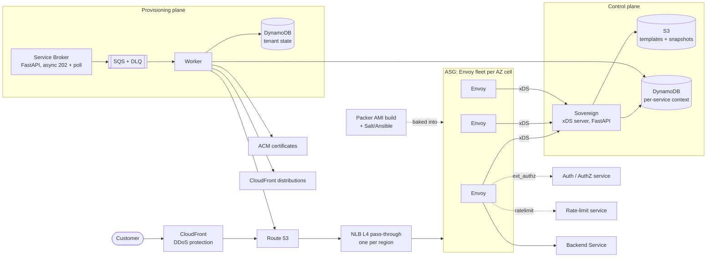

# Product Architecture: Self-Service Edge Load-Balancing Platform

Status: **DRAFT for confirmation.** No implementation has started. Phase 1 starts only after the open questions in section 10 are answered.

Sources:
- `ExcalidrawZ exported at 6 Oct 2026 at 12:02 PM/default/open_service_broker.excalidraw` (platform)
- `docs/diagrams/aws_edge_platform_production.svg` (master production architecture diagram)

Items marked **[TBD]** need a decision or value from the owner. Items marked **(est.)** are estimates, not measurements.

---

## 1. Purpose

A self-service platform where internal teams publish HTTP(S) services to the public internet through a shared, hardened edge. Services are configuration, not infrastructure: onboarding a service never creates a new load balancer.

Non-goals (until confirmed):
- Non-HTTP(S) protocols beyond what the NLB pass-through carries.

## 2. Architecture overview

Three planes:

| Plane | Responsibility | Components |
|---|---|---|
| Data plane | Carries customer traffic | CloudFront, Route 53, NLB, Envoy ASG, backend services |
| Control plane | Renders and distributes Envoy config | Sovereign (xDS, FastAPI), S3 templates, DynamoDB context |
| Provisioning plane | Accepts and executes tenant requests | Service Broker (FastAPI), SQS, Worker, DynamoDB state |

### 2.1 Component diagram

### 2.2 Request path (data plane)

1. Customer resolves the service hostname via Route 53. The record is created only by the Worker.
2. Traffic enters CloudFront, which applies DDoS protection and TLS termination **[TBD: confirm TLS termination point]**.
3. CloudFront forwards to the NLB in the target region. The NLB is L4 pass-through and does not inspect HTTP.
4. The NLB sends traffic to healthy Envoy instances across the three AZs.
5. Envoy runs, in order: route match from the Listener/Route config, `ext_authz` (authentication and authorization), `ratelimit`, then forwards to the backend cluster.
6. Envoy writes an access log entry per request and emits trace context.

### 2.3 Control-plane flow (config distribution)

1. A config change is written to DynamoDB (per-service context) and/or the S3 template set.
2. Sovereign renders xDS resources (Listeners, Routes, Clusters) from templates plus context.
3. Sovereign publishes a versioned snapshot to S3 and serves it over xDS.
4. Each Envoy applies the snapshot, validates it, and writes it to local disk as last-known-good.
5. If Sovereign is unreachable, Envoy keeps serving the last-known-good config (static stability).

**Caveat:** Sovereign's current feature set, xDS resource coverage, and supported Envoy versions are **unverified**. Verify against Sovereign's current docs before Phase 2. Do not design around features that are not confirmed.

### 2.4 Provisioning flow (tenant lifecycle)

1. Client calls the Service Broker with an idempotency key.
2. Broker validates the request, writes a `PENDING` operation to DynamoDB, enqueues to SQS, and returns **202 Accepted** with an operation ID.
3. Worker consumes the message and runs steps in order: ACM certificate, Route 53 record, CloudFront distribution, write per-service context for Sovereign.
4. Each step records its result. On failure, the Worker runs compensating actions for completed steps (for example, delete the Route 53 record if the CloudFront step fails).
5. A tenant becomes visible to Envoy only after all steps succeed. Until then, its context is not published to Sovereign, so no half-applied tenant reaches traffic.
6. Messages that fail repeatedly move to the DLQ. A redrive runbook is required.
7. Client polls the operation ID until `ACTIVE` or `FAILED`.

### 2.5 End-to-end flow: from API call to customer traffic

This section follows one service from the moment someone asks for it, to the moment a customer uses it. Status tags show what exists today.

**Step 1: A team asks for a service.** *(built, not deployed)*
- They call the broker: `PUT /v2/service_instances/<id>` with a service ID, a hostname such as `app1.osb.internal`, and the backend host and port.
- The broker checks the request. A bad hostname or port is rejected with 400 before any work starts.
- It saves the request as `PENDING` in the tenants table, puts a message on the queue, and returns `202` with an operation ID.
- Files: `services/broker/app/main.py`, `services/common/tenants.py`, `infra/modules/provisioning/`.

**Step 2: The team checks progress.** *(built, not deployed)*
- They poll `GET /v2/service_instances/<id>/last_operation` until it says `succeeded` or `failed`.

**Step 3: The worker makes it real.** *(built, not deployed)*
- The worker reads the message from the queue and runs the provisioning steps in order:
  1. Reserves the hostname in the hostnames table, so no two services can take it.
  2. Creates an alias record in the private zone `osb.internal`, pointing at the NLB.
  3. Marks the tenant `ACTIVE`. This is the last step, so a half-finished tenant never reaches traffic.
- If a step fails, the worker undoes the finished steps in reverse and marks the tenant `FAILED`.
- Files: `services/worker/app/saga.py`, `services/worker/app/dns.py`, `services/worker/app/worker.py`.

**Step 4: Sovereign learns about the new tenant.** *(planned, not built)*
- Sovereign reads `GET /internal/context/tenants` from the broker, which returns only `ACTIVE` tenants.
- It fills its listener template with one virtual host per tenant, mapping each hostname to its backend.
- Files: `services/sovereign/config/sovereign.yaml` (context source), `services/sovereign/templates/1.39.2/listeners.yaml.j2` (per-tenant routes, to be written).

**Step 5: Envoy gets the new config.** *(verified with the static test listener)*
- Each Envoy host runs the LKG agent. The agent asks Sovereign for the listeners every 15 seconds.
- The agent checks the response. If it passes, the agent saves it to `/var/lib/osb/lkg/lds.json`, keeping the previous copy as `lds.json.prev`.
- Envoy watches that file and applies any change. It never needs Sovereign to be up at the moment it runs.
- Files: `envoy/lkg-agent/agent.py`, `envoy/bootstrap/envoy-lkg.yaml`, `envoy/install/user_data.sh.tftpl`.

**Step 6: A customer uses the service.** *(path verified; per-tenant routing not built yet)*
- The caller resolves `app1.osb.internal`. The private zone returns the NLB address, and only callers inside the VPC can resolve it.
- The NLB forwards the request to a healthy Envoy host.
- Envoy matches the hostname to its tenant route and sends the request to the backend.
- Today Envoy answers every request with `osb edge ok`, because per-tenant routes aren't built yet.

**Step 7: The service is removed.** *(built, not deployed)*
- The team calls `DELETE /v2/service_instances/<id>`. The worker removes the DNS record, releases the hostname, and marks the tenant `DELETED`.
- Sovereign stops including that tenant on its next refresh. Envoy drops the route when the updated file arrives.

**Who consumes this?** Internal callers inside the VPC only, for now. Public access needs TLS and a public edge, which are not built yet (see section 10 and the remaining work).

**Summary of files read and written along the path:**

| Step | Reads | Writes |
|---|---|---|
| 1. Request | broker code, tenants table | tenants table (`PENDING`), SQS queue |
| 2. Status | tenants table | nothing |
| 3. Provisioning | SQS queue, tenants table | hostnames table, private DNS zone, tenants table (`ACTIVE` or `FAILED`) |
| 4. Context | tenants table via broker (`ACTIVE` only) | Sovereign's in-memory config |
| 5. Config | Sovereign REST output | `/var/lib/osb/lkg/lds.json` on each Envoy host |
| 6. Traffic | private DNS zone, Envoy config file | nothing (request forwarded to backend) |
| 7. Removal | tenants table | private DNS zone, hostnames table, tenants table (`DELETED`) |

## 3. Cell model and failure domains

- **Cell**: one AZ's Envoy fleet within one region. Three cells per region (one per AZ).
- **Fleet**: a set of cells that share a config version rollout. Used for staged change.
- **Failure domains**: AZ, cell, fleet, region, and the global control-plane services (Route 53, CloudFront, ACM, IAM).

Shuffle sharding: tenants are assigned to a subset of Envoy instances so that a noisy or bad tenant affects only the instances in its shard. Shard size and collision probability are **[TBD]**, to be computed in the ADR.

## 4. Functional requirements

| ID | Requirement |
|---|---|
| FR-1 | Onboard a service by API call, with no per-service NLB. |
| FR-2 | Provision DNS, certificate, and CDN for a service asynchronously. |
| FR-3 | Route traffic by host and path to backend clusters, with weighted clusters for AZ draining. |
| FR-4 | Enforce authentication and authorization per service via `ext_authz`. |
| FR-5 | Enforce rate limits per service and per tenant via `ratelimit`. |
| FR-6 | Emit access logs, metrics, and traces from edge to backend. |
| FR-7 | Roll back a tenant or config version to a previous snapshot. |
| FR-8 | Decommission a tenant without affecting other tenants. |

## 5. Resilience requirements (non-negotiable)

1. **Static stability.** If Sovereign, DynamoDB, S3, SQS, or the Broker is down, Envoy keeps serving its last-known-good config from local disk. Live traffic never depends on a control-plane call.
2. **Blast-radius control.** A bad config, bad AMI, or noisy tenant affects at most one cell. Shuffle sharding is justified by a collision calculation in the ADR.
3. **Safe change.** Every config and AMI change is:
   - validated (schema check, then semantic tests against a staging Envoy),
   - rolled out in stages: canary proxies, then one cell, then one region, then all,
   - automatically rolled back when error rate or p99 latency crosses the abort threshold.
   Abort thresholds are **[TBD]** and must be numbers.
4. **AZ and region failure.** AZ draining uses weighted clusters (target: seconds to propagate). Regional failover path is documented. Cross-region replication of desired state: **[TBD]** (S3 cross-region replication, DynamoDB global tables, or equivalent), with the consistency model stated for each.
5. **Control-plane HA.** Multiple Sovereign replicas, versioned snapshots in S3, regional sharding if needed. Proxies back off with exponential backoff and jitter. Alert when config is stale beyond **[TBD] minutes**.
6. **Provisioning safety.** Idempotency keys on every broker request. SQS DLQ with a redrive runbook. Compensating actions for partial failures (for example, ACM issued but Route 53 failed). No half-applied tenants.
7. **Tenant isolation.** Per-service limits on connections, buffers, pending requests, and circuit breakers. Envoy overload manager and memory protection on every instance. Per-tenant quotas enforced by the ratelimit service.
8. **Graceful lifecycle.** Connection draining on scale-in and AMI replacement: health check fails first, then terminate after a drain window. Slow-start for new instances. Jittered reconnect after recovery.

## 6. Scale and capacity

### 6.1 Targets (to fill in)

| Item | Value |
|---|---|
| Regions | **[TBD]** primary, **[TBD]** DR |
| AZs per region | 3 |
| Peak RPS | **[TBD]** |
| Concurrent connections | **[TBD]** |
| Peak bandwidth | **[TBD]** |
| Services at launch / in 24 months | **[TBD]** / **[TBD]** |
| Edge availability SLO | **[TBD]** |
| Config propagation SLO | **[TBD]** seconds |
| Provisioning time-to-ready SLO | **[TBD]** minutes |
| RTO / RPO | **[TBD]** / **[TBD]** |
| Compliance / data residency | **[TBD]** |
| Team size and on-call | **[TBD]** |

### 6.2 Capacity model (to be derived)

- Per-instance capacity comes from load tests on the production AMI, not estimates.
- Record: connections per instance, memory per instance, RPS per instance at target CPU.
- ASG scaling policy and N-1 AZ headroom (the fleet must carry peak load with one AZ down).
- Threshold for adding a new fleet is set from measured numbers.

### 6.3 Config growth

Config size, push latency, and control-plane load grow with service count. The service count at which each one needs sharding is determined by measurement in Phase (i).

### 6.4 AWS quotas that may constrain the design

To be checked against current AWS documentation, not assumed:
- NLBs per region, targets per NLB
- ACM certificates per account
- ENIs per instance and per subnet
- Route 53 change-batch rate and hosted zone record limits
- CloudFront distributions per account
- DynamoDB and SQS throughput limits
- API rate limits for Sovereign's dependencies

### 6.5 Cost drivers (est.)

- NLB LCU and data processing
- Envoy instance hours (dominant at steady state)
- CloudFront egress and requests
- DynamoDB reads and writes
- Cross-AZ data transfer (for example, NLB to Envoy to backend across AZs)

Cheapest scale-out path: add Envoy capacity in existing cells before adding fleets. Costs are estimates until measured.

## 7. Security and governance

- Public exposure only through this platform. The Worker is the only identity that creates Route 53 records and CloudFront distributions for tenants.
- KMS-encrypted volumes on Envoy instances. Least-privilege IAM instance profile. Security groups restrict traffic to the NLB and to the control plane.
- Certificates from ACM. Certificate expiry is monitored with alerts well before expiry.
- Authentication and authorization decisions are made by `ext_authz`, not in the backend.
- **[TBD]** Secret handling for backend credentials.

## 8. Observability and operations

- **Metrics, logs, traces** from CloudFront through NLB and Envoy to the backend, with trace context propagated end to end.
- **Per-tenant dashboards** and per-tenant error budgets.
- **Deployment annotations** on dashboards for every config push and AMI rollout, so error-rate changes can be correlated to a change.
- **SLOs and error budgets** per the targets in section 6.1.
- **Alerts with runbooks.** Every alert links to a runbook. Alert thresholds are **[TBD]**.
- **Game days** per the test plan in section 9.

## 9. Delivery phases

Work proceeds one phase at a time. Each phase stops for review.

| Phase | Scope | Exit criteria |
|---|---|---|
| (a) | AMI pipeline (Packer + Salt/Ansible) | Reproducible AMI build; scan passes; smoke test passes |
| (b) | One-region NLB + ASG + Envoy | Traffic served end to end in one region; health checks and drain verified |
| (c) | Control plane with dynamic config | Config change reaches Envoy within the propagation SLO; last-known-good verified |
| (d) | Broker + worker | Idempotent, async provisioning; DLQ and compensation tested |
| (e) | Edge policy | ext_authz and ratelimit enforced per service |
| (f) | Safety | Validation, staged rollout, automatic rollback, last-known-good |
| (g) | Cells and multi-AZ draining | AZ loss handled with no customer-visible outage beyond the SLO |
| (h) | Multi-region and DR | Regional failover runbook executed in a drill |
| (i) | Scale and chaos validation | Load and soak tests at production shape; failure injection passes |

### 9.1 Test plan per phase

- Unit and contract tests
- Sandbox integration tests
- Staging at production shape
- Load and soak tests
- Failure injection: control plane down, DynamoDB down, SQS backlog, S3 unavailable, AZ loss, bad config, certificate expiry, noisy tenant

### 9.2 Deliverables per phase

Code, IaC, tests, runbook, dashboards and alerts, and an acceptance checklist with pass/fail criteria tied to the SLOs.

## 10. Open questions (answer before Phase (a))

1. Configuration management: Salt or Ansible?
2. Infrastructure as code: CloudFormation or Terraform?
3. Where does TLS terminate: CloudFront, NLB, Envoy, or a combination?
4. Who may call the Service Broker: internal teams only, or external?
5. Which regions, and which residency rules apply?
6. Are CloudFront distributions per tenant or shared?
7. Targets in section 6.1: which values are known now?

## 11. Assumptions

- Three AZs per region.
- Envoy is the data-plane proxy and Sovereign is the xDS control plane. Sovereign's features are unverified (see 2.3).
- Route 53, CloudFront, and ACM are the only DNS, CDN, and certificate services.
- The Worker is the only component with permission to change tenant DNS and CDN resources.

## 12. Glossary

- **xDS**: Envoy's discovery APIs (LDS, RDS, CDS, EDS) for dynamic config.
- **ext_authz**: Envoy filter that calls an external service for auth decisions.
- **Cell**: an independent unit of capacity, here one AZ's Envoy fleet in one region.
- **Shuffle sharding**: assigning each tenant to a random subset of instances to limit blast radius.
- **Last-known-good (LKG)**: the most recent config that Envoy applied and validated.
